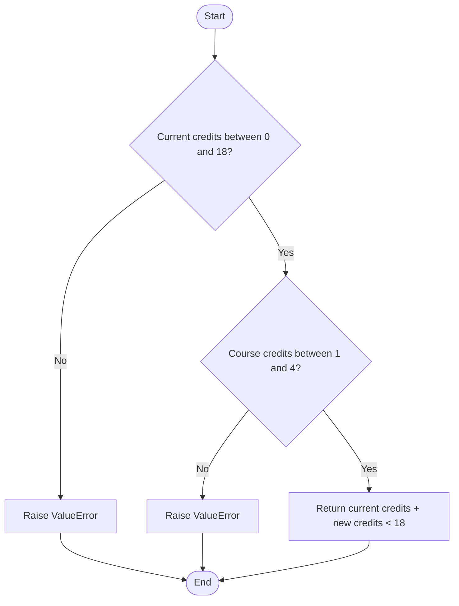
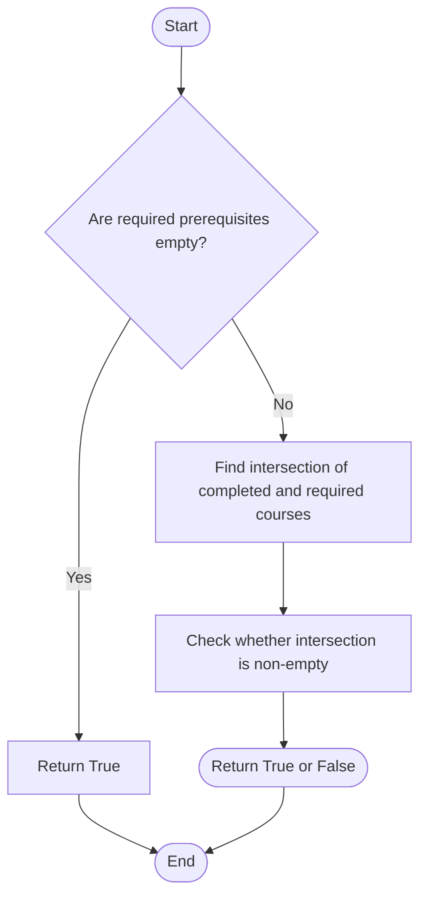
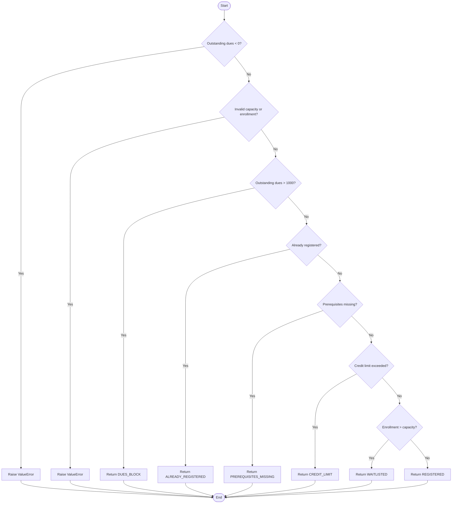
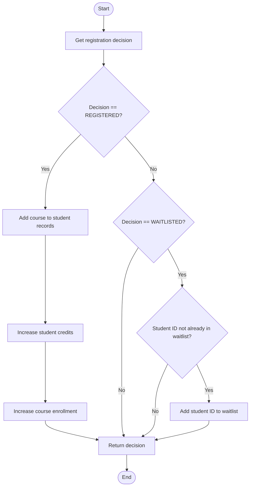
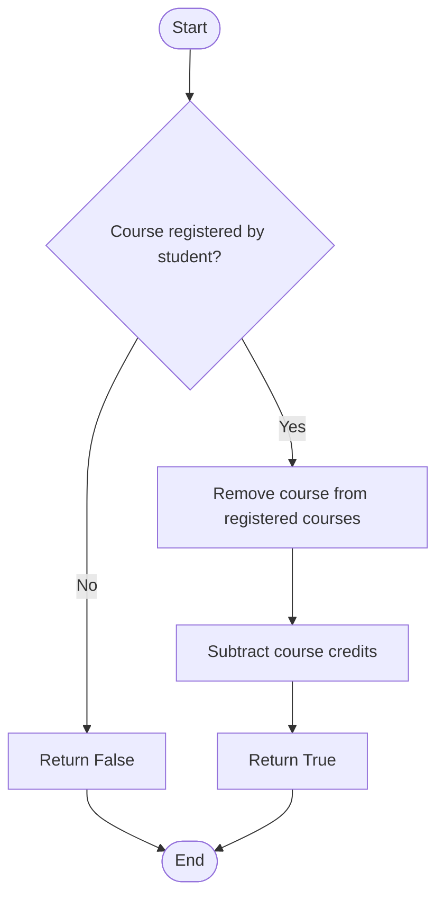

# Part B – White-Box Testing

## 1. Control Flow Graph (CFG)

A Control Flow Graph represents the execution flow of a program. It shows statements, decisions, and possible execution paths.

### Function 1: check_credit_limit()

**Purpose:** Checks whether the student's current credits and new course credits are within the permitted limits.

**Decision Points:**

1. Check whether current credits are between 0 and 18.
2. Check whether new course credits are between 1 and 4.

**Control Flow:**

- Start.
- Check current credits.
  - If invalid, raise ValueError.
  - If valid, check course credits.
- Check course credits.
  - If invalid, raise ValueError.
  - If valid, calculate and return the credit-limit result.
- End.

### Cyclomatic Complexity

Formula:

V(G) = Number of decision points + 1

Number of decision points = 2

V(G) = 2 + 1 = 3

**Cyclomatic Complexity = 3**

### Independent Paths

| Path | Execution |
|---|---|
| P1 | Invalid current credits → ValueError |
| P2 | Valid current credits → Invalid course credits → ValueError |
| P3 | Valid current credits → Valid course credits → Return result |

A minimum of three independent paths is required to cover the control flow of this function.

### Control Flow Graph



---

### Function 2: prerequisites_satisfied()

**Purpose:** Checks whether the student has completed the required prerequisite courses.

**Decision Point:**

1. Check whether the required prerequisite set is empty.

**Control Flow:**

- Start.
- Check whether prerequisites are required.
  - If no prerequisites are required, return True.
  - Otherwise, find the intersection between completed and required courses.
- Return True if the intersection is non-empty; otherwise, return False.
- End.

### Cyclomatic Complexity

V(G) = Number of decision points + 1

Number of decision points = 1

V(G) = 1 + 1 = 2

**Cyclomatic Complexity = 2**

### Independent Paths

| Path | Execution |
|---|---|
| P1 | No prerequisites required → Return True |
| P2 | Prerequisites required → Check intersection → Return result |

A minimum of two independent paths is required for this function.

### Control Flow Graph



---

### Function 3: registration_decision()

**Purpose:** Evaluates whether a student can register for a course without modifying student or course records.

**Decision Points:**

1. Check whether outstanding dues are negative.
2. Check whether course capacity and enrollment values are valid.
3. Check whether outstanding dues are greater than 1000.
4. Check whether the student is already registered.
5. Check whether prerequisites are satisfied.
6. Check whether the credit limit is satisfied.
7. Check whether course enrollment is greater than capacity.

### Cyclomatic Complexity

V(G) = Number of decision points + 1

Number of decision points = 7

V(G) = 7 + 1 = 8

**Cyclomatic Complexity = 8**

### Independent Paths

| Path | Execution |
|---|---|
| P1 | Negative dues → ValueError |
| P2 | Valid dues → Invalid capacity/enrollment → ValueError |
| P3 | Valid inputs → Dues greater than 1000 → DUES_BLOCK |
| P4 | No dues block → Already registered → ALREADY_REGISTERED |
| P5 | Not registered → Prerequisites missing → PREREQUISITES_MISSING |
| P6 | Prerequisites satisfied → Credit limit not satisfied → CREDIT_LIMIT |
| P7 | Credit limit satisfied → Enrollment greater than capacity → WAITLISTED |
| P8 | All conditions passed → REGISTERED |

These represent the eight theoretical independent paths through the function. However, P7 is unreachable in the supplied implementation because the earlier validation rejects enrollment greater than capacity.

### Control Flow Graph



---

### Function 4: register_course()

**Purpose:** Applies the registration decision and updates student or course records when necessary.

**Decision Points:**

1. Check whether the registration decision is REGISTERED.
2. Check whether the registration decision is WAITLISTED.
3. Check whether the student ID is not already present in the waitlist.

The third decision contains a short-circuit AND condition, which introduces an additional condition in the control flow.

### Cyclomatic Complexity

V(G) = Number of decision points + 1

Number of decision points = 3, including the short-circuit condition.

V(G) = 3 + 1 = 4

**Cyclomatic Complexity = 4**

### Independent Paths

| Path | Execution |
|---|---|
| P1 | Decision is REGISTERED → Update student and course records |
| P2 | Decision is not REGISTERED and not WAITLISTED → Return decision |
| P3 | Decision is WAITLISTED and student is not already listed → Add student ID |
| P4 | Decision is WAITLISTED and student is already listed → Do not add duplicate |

A minimum of four independent paths is required for this function. The WAITLISTED paths cannot be reached through the original registration decision when using valid inputs.

### Control Flow Graph



---

### Function 5: withdraw_course()

**Purpose:** Removes a student's course registration and updates the student's credit hours.

**Decision Point:**

1. Check whether the course is not present in the student's registered courses.

### Cyclomatic Complexity

V(G) = Number of decision points + 1

Number of decision points = 1

V(G) = 1 + 1 = 2

**Cyclomatic Complexity = 2**

### Independent Paths

| Path | Execution |
|---|---|
| P1 | Course not registered → Return False |
| P2 | Course registered → Remove course → Subtract credits → Return True |

**Defect Identified:** The original function does not decrease the course enrollment count after withdrawal. This violates FR-13.

### Control Flow Graph



---

## 2. Overall Cyclomatic Complexity

Cyclomatic complexity measures the number of independent paths in a program.

Formula:

V(G) = Number of decision points + Number of connected components

| Function | Decision Points | Cyclomatic Complexity |
|---|---:|---:|
| check_credit_limit() | 2 | 3 |
| prerequisites_satisfied() | 1 | 2 |
| registration_decision() | 7 | 8 |
| register_course() | 3 | 4 |
| withdraw_course() | 1 | 2 |
| **Total** | **14** | **19** |

Total cyclomatic complexity:

V(G) = 14 + 5

**Overall Cyclomatic Complexity = 19**

The value 19 represents the sum of the individual function complexities. It is not the complexity of one connected control flow graph.

---

## 3. Modified Condition/Decision Coverage (MC/DC)

MC/DC stands for Modified Condition/Decision Coverage. It checks whether each individual condition can independently affect the outcome of a decision.

### Conditions in registration_decision()

| ID | Condition |
|---|---|
| C1 | Outstanding dues are negative |
| C2 | Course capacity or enrollment is invalid |
| C3 | Outstanding dues are greater than 1000 |
| C4 | Student is already registered |
| C5 | Prerequisites are missing |
| C6 | Credit limit is exceeded |
| C7 | Enrollment is greater than capacity |

### MC/DC Test Cases

| Test | Condition being tested | Expected result |
|---|---|---|
| T1 | C1 = True | ValueError |
| T2 | C2 = True, with C1 = False | ValueError |
| T3 | C3 = True, with earlier validations passing | DUES_BLOCK |
| T4 | C4 = True, with earlier conditions passing | ALREADY_REGISTERED |
| T5 | C5 = True, with earlier conditions passing | PREREQUISITES_MISSING |
| T6 | C6 = True, with earlier conditions passing | CREDIT_LIMIT |
| T7 | C7 = True, with earlier conditions passing | WAITLISTED |

### Paired MC/DC Test Scenarios

Each pair changes one condition while keeping the other relevant inputs unchanged.

| Pair | Test case A | Test case B | Actual behavior in supplied implementation |
|---|---|---|---|
| C1 | Outstanding dues = -1 | Outstanding dues = 0 | ValueError / Continue |
| C2a | Enrolled = -1, capacity = 30 | Enrolled = 0, capacity = 30 | ValueError / Continue |
| C2b | Enrolled = 31, capacity = 30 | Enrolled = 30, capacity = 30 | ValueError / Continue |
| C2c | Enrolled = 0, capacity = 0 | Enrolled = 0, capacity = 1 | ValueError / Continue |
| C3 | Outstanding dues = 1001 | Outstanding dues = 0 | DUES_BLOCK / Continue |
| C4 | Course already registered | Course not registered | ALREADY_REGISTERED / Continue |
| C5 | No matching prerequisite completed | At least one matching prerequisite completed | PREREQUISITES_MISSING / Continue |
| C6 | Current credits = 16, new credits = 3 | Current credits = 14, new credits = 3 | CREDIT_LIMIT / REGISTERED |

For C1–C6, all earlier validation and priority conditions must be satisfied when testing the relevant condition.

### Unreachable Decision: C7

The source code checks whether enrollment is greater than capacity:

```python
course.enrolled > course.capacity
```

However, an earlier validation rejects enrollment greater than capacity. Therefore, the WAITLISTED branch cannot be reached with valid input in the original implementation.

This is an identified control-flow problem. Strict MC/DC coverage for this branch cannot be demonstrated using valid inputs until the defect is corrected.

### MC/DC Conclusion

The paired scenarios examine the independent effect of reachable decisions. The prerequisite pair also exposes a defect: the implementation accepts a student who has completed only one of multiple required prerequisites.

The WAITLISTED condition is unreachable because of conflicting validation logic. Therefore, full MC/DC coverage has not been claimed.

---

## 4. Statement and Branch Coverage

Coverage was measured using pytest-cov with branch coverage enabled.

Command used:

```bash
python -m pytest --cov=registration --cov-branch --cov-report=term-missing
```

### Coverage Results

| Metric | Total | Covered | Coverage |
|---|---:|---:|---:|
| Statement coverage | 53 | 49 | 92.45% |
| Branch coverage | 26 | 21 | 80.77% |
| Combined coverage | — | — | 89% |

### Missing Coverage

The coverage report identified four statements that were not executed: lines 55, 59, 70, and 71.

Five branch outcomes were not covered.

The WAITLISTED branch is unreachable in the original implementation because the earlier validation rejects enrollment greater than capacity.

### Analysis and Conclusion

The original implementation achieved 92.45% statement coverage and 80.77% branch coverage. The combined coverage reported by coverage.py was 89%.

The remaining uncovered statements and branches indicate areas where additional tests or changes to the implementation are required. The original implementation was kept unchanged to preserve evidence of its defects.

---

## 5. Overall Conclusion

White-box testing examined the internal structure of the Student Course Registration System through control flow graphs, cyclomatic complexity, independent paths, MC/DC test scenarios, and code coverage.

The five functions have a combined cyclomatic complexity of 19. The test suite achieved 92.45% statement coverage and 80.77% branch coverage.

White-box testing also highlighted unreachable waitlist logic and other defects in the supplied implementation. Together with black-box testing, these findings provide evidence for evaluating the system against its requirements.